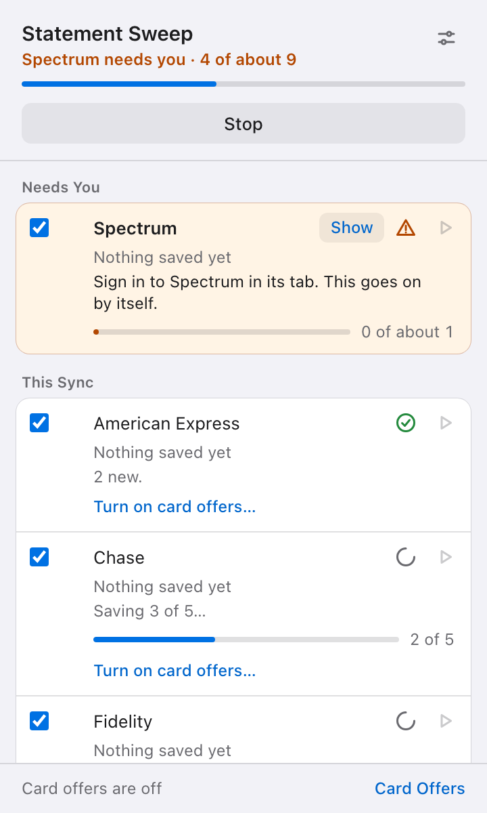
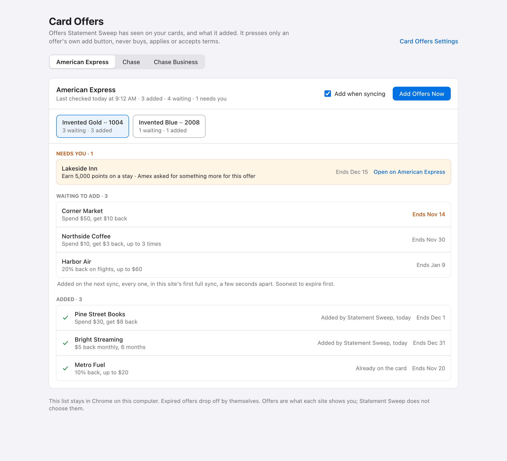

# Statement Sweep

[](https://github.com/JasperDale420/statement-sweep/actions/workflows/ci.yml)
[](LICENSE)

A Chrome extension that saves your own statements, bills and tax forms from
the financial sites you already sign in to. It runs in your own Chrome, uses
your own sign-ins and password manager, stores no passwords, and sends
nothing anywhere.

<p align="center">
  
</p>

## What it does

- **Saves what is new.** Press **Get New Documents** and every site that may
  have something new runs at once, each in a tab of its own. Each document is
  saved once, with the name and folder you choose. Nothing is saved twice.
- **Knows what is due.** From the dates of what it has saved, it learns each
  site's schedule (monthly, quarterly, yearly) and how many days after its
  date each site posts it. It flags a site only when something can be there.
  A site checked with nothing new waits a few days, and possible gaps in your
  history are pointed out. Tax forms are looked for in tax season.
- **Shows how far it has got.** Each site has a progress bar, and so does the
  whole sync. Totals are "about" until a site's list is read, then exact.
  **Stop** ends the sync and keeps what was saved.
- **Waits for you, not the other way round.** When a site needs you to sign
  in or confirm it is you, it says so in the popup and in a small card in the
  site's own tab. It never types a password or a code. Once you are in, it
  carries on by itself.
- **Adds your card offers, if you want.** See [Card offers](#card-offers).
- **Keeps a record.** Each run writes a log per site with counts, steps and
  reasons, never your account details. History can be exported and imported,
  so a new copy does not save everything again.

## Sites

25 sites are switched on. Each is a recipe in `providers/`, tested in a real
Chromium against stand-in pages.

| Kind | Sites |
|---|---|
| Cards | American Express, Apple Card, Bilt Card, Chase, Chase Business |
| Banks | First Horizon Bank, Simmons Bank, Optum Bank (HSA) |
| Investing | Alpaca, Coinbase, Fidelity, Fidelity NetBenefits, Interactive Brokers, Robinhood, Wealthfront, TreasuryDirect |
| Payments | PayPal, Venmo |
| Bills and loans | Nelnet, SDG&E, Spectrum |
| Insurance and government | State Farm, IRS, Shelby County Trustee |
| Receipts | Apple |

Sites change their pages without notice, so a recipe can break. If one
does, [open an issue](https://github.com/JasperDale420/statement-sweep/issues/new/choose).
To add a site for yourself, see [Adding a site](#adding-a-site). To add a
built-in recipe for everyone, see [providers/README.md](providers/README.md).

## Adding a site

A site that is not built in can be added from its own statements page.

1. Sign in and open the page that lists your statements.
2. Press the extension's icon, then **Add This Site…** at the bottom.
   Chrome asks to let Statement Sweep read that one site.
3. Click the link you would press to open one statement. Nothing opens:
   Statement Sweep finds the other links like it and outlines them in green,
   with the dates it read for them.
4. Check the name, choose whether the first sync saves every statement
   there or only new ones from now on, and press **Add Site**.

The site then syncs with the others, with its own progress bar, schedule and
log. What is kept for it is the pattern of the link you picked, its row and
where its date is, never the page's text, an account number or a full
address. **Settings → Sites You Added** shows how its last sync went, picks
a link again if the site changes its page, or removes it and gives back its
access. Statements already saved stay saved.

Add This Site works only where each statement is a link you can click. Sites
that show statements in a viewer, behind a form or a date picker, need a
built-in recipe instead.

## Install

1. Download or clone this repository.
2. Open `chrome://extensions`, turn on **Developer mode**, press **Load
   unpacked**, and choose the folder.
3. Press the extension's icon, then **Get New Documents**, or the play button
   beside one site.

Files go to Downloads under `Statement Sweep/`, one folder per site.
**Settings**, the sliders button in the popup, changes the folders and file
names or sends everything to any folder you choose. It also switches sites
off and turns on card offers.

## Card offers

For American Express, Chase and Chase Business, Statement Sweep can add your
card offers after it saves that site's statements. It is off until you turn
it on for a site in Settings.

- A site's first sync adds every offer on every card. Later syncs add only
  the new ones. It never adds an offer twice, and skips offers already on
  your card.
- It presses only each offer's own add button, a few seconds apart, soonest
  to expire first. It never buys, applies, enrolls or accepts terms.
- It stops at once on a sign-out, a security check, or a site saying to slow
  down. An offer the site asks more for is left for you.
- The **Card Offers** page lists what each card showed: what needs you, what
  is waiting, and what was added.

<p align="center">
  
</p>

## Privacy

Nothing leaves your browser. Statement Sweep has no server, no account and no
analytics. It never sees a password. Documents go only to your own folder,
and its record of what was saved stays in Chrome on your computer. See the
[privacy policy](PRIVACY.md).

## Use at your own risk

Statement Sweep is free software, provided **as is**, with **no warranty of
any kind**. It is not affiliated with or endorsed by any bank, card issuer or
other site it works with. You use it on your own accounts, at your own risk,
and you are responsible for following each site's terms of use. Check that
the documents you need were saved. Card offers come with the merchant's and
issuer's terms. Nothing here is financial, tax or legal advice.

To the fullest extent the law allows, the authors and contributors are not
liable for any loss or damage from using it. That includes missing, duplicate
or wrong documents, a locked or flagged account, offers added or not added,
fees, and lost data. Sections 15 to 17 of the [license](LICENSE) say this in
full.

## Develop

```bash
pip install -r requirements-dev.txt && python -m playwright install chromium
python3 tools/build.py          # regenerate the site list after editing a *.meta.json
python3 tools/privacy_check.py  # nothing personal in the repository
python -m pytest -n auto --dist loadfile
python3 tools/package.py        # the Chrome Web Store upload
```

Read [CONTRIBUTING.md](CONTRIBUTING.md) before opening a pull request: its
safety rules come first. Security problems go privately, as
[SECURITY.md](SECURITY.md) says. Changes are listed in
[CHANGELOG.md](CHANGELOG.md).

## Credits and license

Inspired by and based on [PaperPull](https://github.com/rheeloaded/paperpull).
Credit for the idea and the site-by-site work behind these recipes belongs to
its authors. Statement Sweep is an independent project, not made or endorsed
by PaperPull or TNE Enterprises LLC. See [NOTICE.md](NOTICE.md).

Licensed under the [GNU Affero General Public License v3](LICENSE), the same
as PaperPull. Site names are the trademarks of their owners and are used only
to say which sites it works with.
